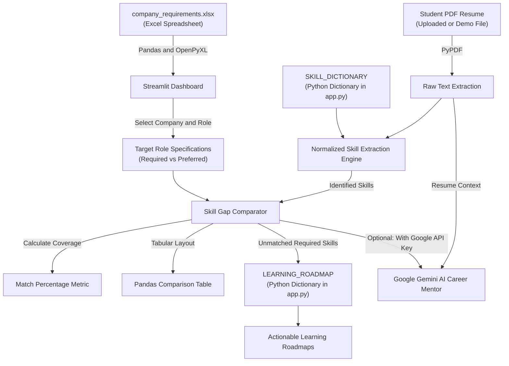

# 🎯 AI-Powered Company Requirement-Based Resume Skill Gap Analyzer

An educational, web-based career-readiness application designed for **BCA NTCC project evaluation**. 

The system benchmarks a student's uploaded PDF resume against predefined company job specifications maintained in an **Excel spreadsheet (`company_requirements.xlsx`)** to identify **demonstrated competencies**, **critical skill gaps**, and **tailored learning roadmaps**.

---

## 📌 1. Project Abstract & Objective

### Objective
In campus placements, students frequently apply for technical roles without knowing whether their resumes explicitly demonstrate the competencies expected by hiring companies. 

This project provides an objective, transparent, and educational self-assessment tool that answers three core questions:
1. **Which required skills are already demonstrated in the student's resume?**
2. **Which company-required skills are missing or not clearly demonstrated?**
3. **What concrete topics, exercises, and mini-projects should the student learn to become job-ready?**

> **Educational Assessment Notice:** This system is an educational readiness comparator designed to help students discover topics to study. The match percentage is a skill-coverage indicator, **not** an official company hiring score or automated ATS rejection algorithm.

---

## 🛠️ 2. Technology Stack

- **Programming Language:** Python 3.10+
- **User Interface:** Streamlit (clean interactive web dashboard)
- **Spreadsheet Processing:** Pandas & OpenPyXL (reads and filters `company_requirements.xlsx`)
- **PDF Extraction:** PyPDF (`pypdf.PdfReader` for digital text-based resumes)
- **Skill Extraction & Normalization:** Built-in Python dictionary with regex word-boundary pattern matching `(?<!\w)alias(?!\w)`
- **Learning Roadmaps:** Internal Python roadmap dictionary providing structured study guides
- **Optional AI Mentor:** Google Gemini API (`gemini-flash-lite-latest` / `gemini-3-flash-preview`) for personalized 4-week study plans

*Note: No JSON files, SQL databases, React, or FastAPI are required. The entire core application functions 100% locally and offline.*

---

## 🏗️ 3. System Architecture & Workflow




## 📁 4. Project Directory Structure

```text
resume-skill-gap-analyzer/
│
├── app.py                      # Main Streamlit web application (UI, Excel parser, & matching logic)
├── company_requirements.xlsx   # Company job specifications spreadsheet (Excel)
├── requirements.txt            # Python dependencies (Streamlit, Pandas, OpenPyXL, PyPDF)
├── .env.example                # Optional Google API key template
├── .gitignore                  # Git ignore rules for venv, .env, and cache
├── README.md                   # Complete NTCC project documentation and viva defense guide
│
├── sample_resume_generator.py  # Script generating sample resumes for evaluation testing
├── sample_resume_match.pdf     # 100% Match test resume (Rohan Sharma -> Python Developer)
├── sample_resume_partial.pdf   # Partial Match test resume (Priya Patel)
├── sample_resume_nonmatch.pdf  # 0% Match test resume (Amit Verma -> Graphic Designer)
├── sample_resume_blank.pdf     # Blank test resume (Error handling verification)
└── test_analyzer.py            # Automated test suite verifying all 12 project test cases
```

---

## 📊 5. Excel Requirements Spreadsheet (`company_requirements.xlsx`)

The requirements file uses one row per company and role, with skills separated by commas:

| Company Name | Job Role | Required Skills | Preferred Skills | Qualification | Experience Level |
|---|---|---|---|---|---|
| **DemoTech Labs** | Python Developer | Python, Object-Oriented Programming, SQL, Git, REST APIs, Unit Testing | FastAPI, Docker, Linux | BCA, BSc CS, B.Tech | Entry-level (0-1 yr) |
| **DemoTech Labs** | Machine Learning Intern | Python, NumPy, Pandas, Machine Learning, Data Visualization, Git | Scikit-Learn, SQL, Deep Learning | BCA, BSc IT/CS | Final Year / Intern |
| **CloudMatrix Analytics** | Data Analyst Intern | SQL, Python, Pandas, Data Analysis, Data Visualization | Excel, Power BI, Tableau, Git | BCA, B.Com, BSc Stats | Final Year Student |
| **CloudMatrix Analytics** | Full Stack Web Developer | HTML / CSS, JavaScript, Python, SQL, REST APIs, Git | React, FastAPI, Docker | BCA, BSc CS | Entry-level (0-1 yr) |
| **Apex Software Solutions** | Junior Software Engineer | Python, Object-Oriented Programming, Data Structures, SQL, Git | C++, Java, REST APIs, Unit Testing | BCA, BSc IT | Fresh Graduate |

> **Extensibility:** To add a new company or role, simply open `company_requirements.xlsx` in Microsoft Excel, LibreOffice, or Google Sheets, add a new row, and save. The application updates automatically without changing Python code!

---

## ⚙️ 6. Setup & Execution Guide (macOS / Terminal)

### Step 1: Open Terminal & Activate Virtual Environment
```bash
cd /Users/arushikumari/Desktop/ntcc
source venv/bin/activate
```

### Step 2: Install Dependencies
```bash
pip install -r requirements.txt
```

### Step 3: Run the Automated Test Suite
Verify that all 12 test cases pass with 100% success:
```bash
python test_analyzer.py
```

### Step 4: Run the Streamlit Application
```bash
streamlit run app.py
```
Open **`http://localhost:8501`** in your browser.

---

## 🧪 7. Verified Test Cases & Recorded Results

All 12 tests below were verified by [`test_analyzer.py`](file:///Users/arushikumari/Desktop/ntcc/test_analyzer.py):

| # | Test Scenario | Action / Input | Recorded Actual Result | Status |
|---|---|---|---|:---:|
| **1** | Excel Requirements Loading | Read `company_requirements.xlsx` | Successfully loaded 5 distinct roles across 3 companies. | ✅ Pass |
| **2** | Missing Excel Handling | Request non-existent spreadsheet | Caught gracefully: *"Requirements spreadsheet not found..."* | ✅ Pass |
| **3** | Comma-separated Parsing | Cell with comma-separated skills | Correctly split and stripped into individual skill tokens. | ✅ Pass |
| **4** | Valid Resume Extraction | Read `sample_resume_match.pdf` | Extracted 1,144 characters across all sections. | ✅ Pass |
| **5** | Empty / Unreadable PDF | Read `sample_resume_blank.pdf` | Caught 0-page text; displayed helpful user guidance. | ✅ Pass |
| **6** | 100% Match Scenario | Rohan Sharma vs Python Dev | Matched all 6 required skills -> **100.0% Match**. | ✅ Pass |
| **7** | Partial Match Scenario | Priya Patel vs Python Dev | Matched Python & SQL; flagged 4 missing skills -> **33.3% Match**. | ✅ Pass |
| **8** | Non-Match Scenario | Amit Verma vs Python Dev | Matched 0 skills -> **0.0% Match**. | ✅ Pass |
| **9** | False-Positive Prevention | "restaurant", "digital", "cloud" | Word boundaries prevented false matches for REST, Git, and C. | ✅ Pass |
| **10**| Learning Roadmap Lookup | Missing skills from Priya's test | Retrieved detailed topics, exercises, and mini-projects. | ✅ Pass |
| **11**| Dynamic Role Switching | Priya switched to Data Analyst | Match score dynamically jumped from **33.3%** to **80.0%**. | ✅ Pass |
| **12**| Excel Extensibility | Appended row to DataFrame | New company and role recognized without modifying code. | ✅ Pass |

---

Action Plan report.
- Placement cell batch mode to analyze multiple student resumes against an opening simultaneously.
